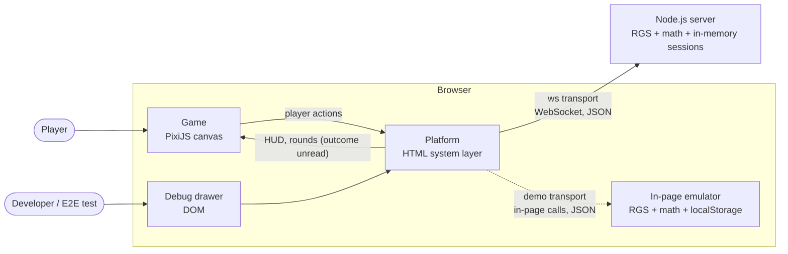
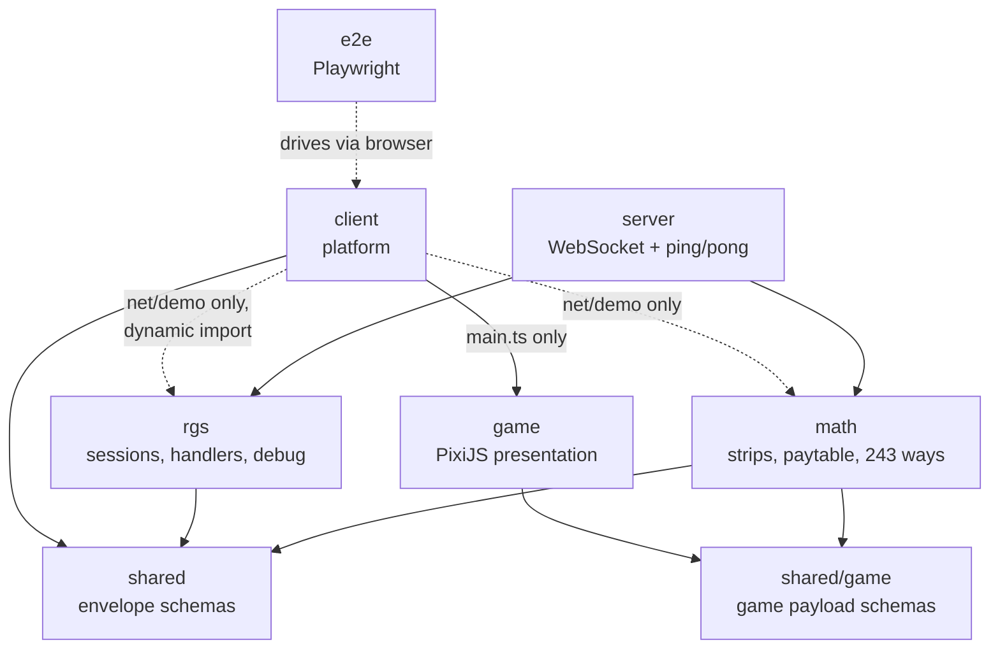
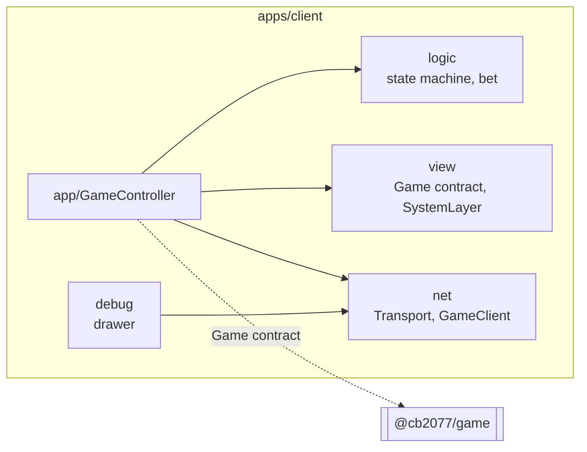
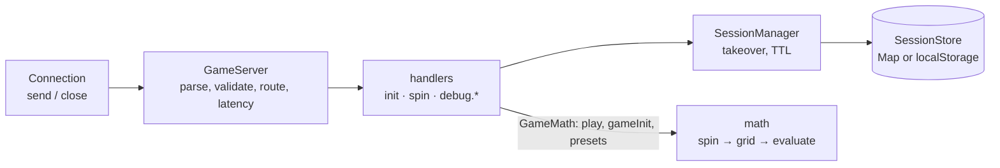
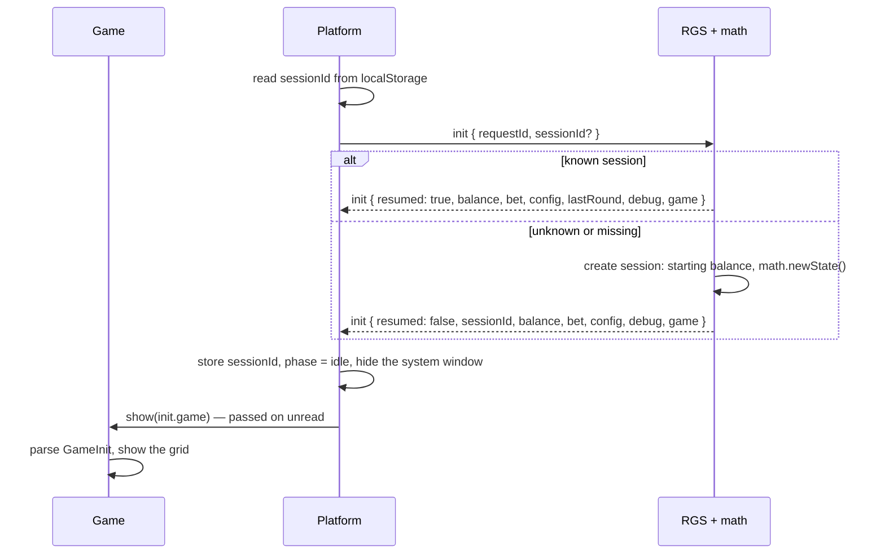
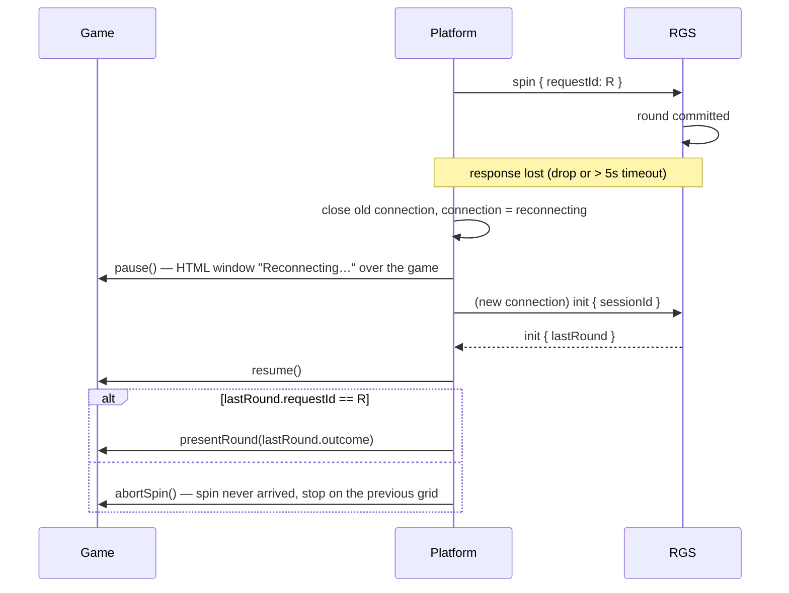
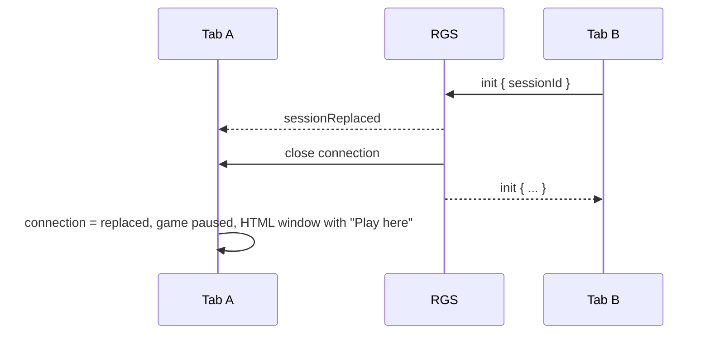
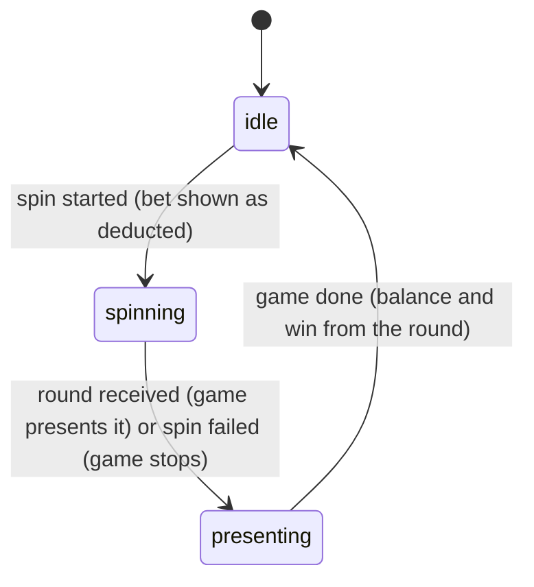
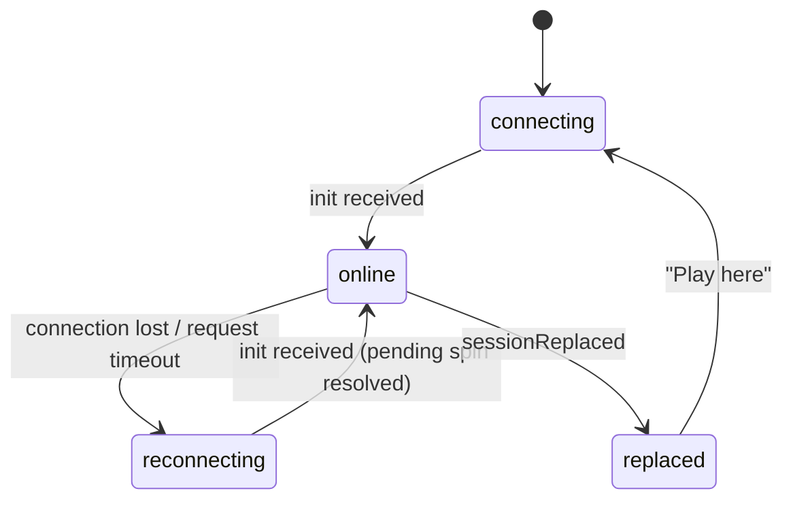

# Architecture overview

## Layers

The repository mirrors how a production slot is split
([ADR 014](../adr/014-platform-rgs-and-self-contained-game.md)):

| Production layer    | Here                                | Owns                                                                                |
| ------------------- | ----------------------------------- | ----------------------------------------------------------------------------------- |
| Platform (wrapper)  | `apps/client`                       | page, connection, round lifecycle, money and bets, money formatting, HTML system UI |
| Game (presentation) | `packages/game`                     | its own canvas, scene, reels, bottom panel, the whole round presentation            |
| RGS core            | `packages/rgs` + `apps/server` host | sessions, rounds, balance, bet limits, last-round recovery, debug commands          |
| Game math           | `packages/math`                     | reel strips, paytable, 243 ways, debug presets                                      |
| Protocol            | `packages/shared`                   | the envelope (`@cb2077/shared`) and the game payload (`@cb2077/shared/game`)        |

The generic layers (platform, RGS) define a contract and carry the game's data as an opaque
payload (`unknown`). The game's layers (presentation, math) import nothing from the platform or
the RGS and match the contracts by shape.

## System context

The platform talks to the RGS through a `Transport`. Two transports exist (ADR 012):

- **ws** — a Node.js server reached over WebSocket (development, E2E);
- **demo** — the same RGS and math running inside the page, no server (GitHub Pages).



## Packages

Deployable apps live in `apps/` (`client`, `server`), libraries in `packages/` (`shared`, `game`,
`rgs`, `math`) and the E2E suite in `e2e/` ([ADR 002](../adr/002-monorepo-pnpm-workspaces.md)).



`rgs` does not depend on `math`, and `client` does not depend on the game's code beyond
`main.ts`: the composition roots (`main.ts`, `apps/server/src/index.ts`, `net/demo`) wire the
game's packages into the generic ones.

### Platform layers (ADR 006)



`logic` and `view` never import each other or `net`; only `app/GameController` wires them.

### Contract between the platform and the game

```ts
// apps/client/src/view/Game.ts (abridged)
interface Game {
  setActions: (actions: PlayerActions) => void; // spin, bet − / +, step
  show: (game: unknown) => void; // init.game
  update: (state: HudState) => void; // balance, bet, step, win, enabled controls
  startSpin: () => void;
  presentRound: (outcome: unknown, summary: { totalWin: Cents }) => Promise<void>;
  abortSpin: () => Promise<void>;
  pause: () => void; // a system window is open: animation and game time stop
  resume: () => void;
}
```

### RGS and math



The RGS stores the math's `gameState` and forwards its `outcome` without reading either.

## Key flows

### Start and init



### Spin

```mermaid
sequenceDiagram
  participant G as Game
  participant P as Platform
  participant S as RGS + math
  G->>P: spinPressed()
  P->>P: balance shown −= bet, phase = spinning
  P->>G: startSpin() — reels start at once
  P->>S: spin { requestId, bet }
  S->>S: validate bet, math.play() → outcome, totalWin; update balance
  S-->>P: spin { round: envelope + outcome }
  P->>P: wait the minimum spin time, phase = presenting
  P->>G: presentRound(round.outcome, { totalWin })
  G->>G: parse SpinOutcome, stop reels, highlight wins, show the total
  G-->>P: resolved
  P->>P: balance = round.balance, phase = idle
```

### Connection lost during a spin



### Second tab takes over the session



## Platform state

The platform tracks two independent things in `logic/GameModel`, because a connection can drop
in any spin phase. It works with the round's envelope only; how a round looks is the game's
business.

**Spin phase** (`logic/SpinStateMachine`):



**Connection** (driven by `net/GameClient`):



While `reconnecting`, a spin in flight keeps spinning (the game is paused under the system
window); after `init` it is either presented (`lastRound.requestId` matches) or stopped on the
previous grid as not played (ADR 009). Spin and bet controls are enabled only when the
connection is `online` and the phase is `idle`. If the game cannot present a round, the platform
shows a notice; the round's money counts as the server reported it. If the game cannot read
`init.game`, or the RGS answers `init` with an error, the game cannot start: the platform shows a
blocking window asking to reload, and spins stay disabled until an `init` succeeds.
